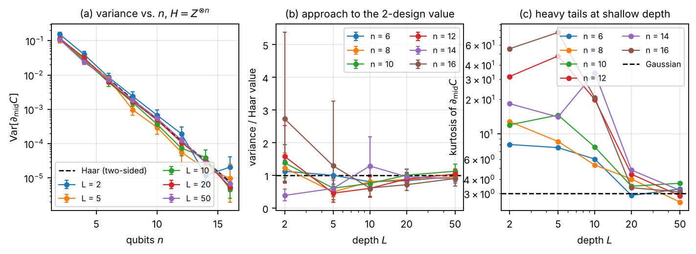
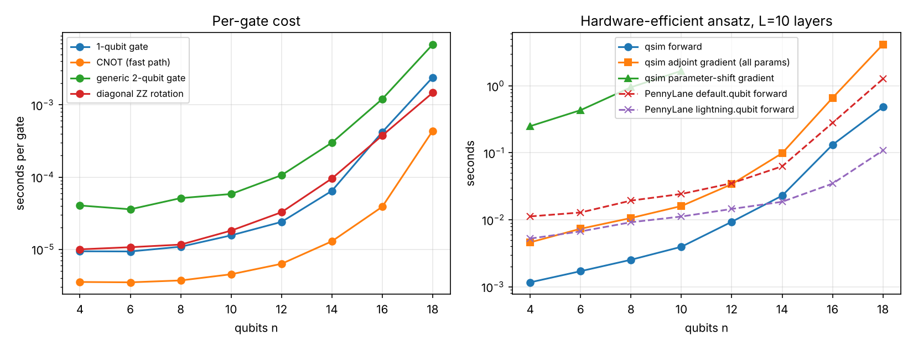

# Barren Plateaus from Scratch

[](https://github.com/USER/bp-from-scratch/actions/workflows/tests.yml)
[](paper/paper.pdf)
[](LICENSE)

A from-scratch NumPy state-vector simulator (`qsim`) and a reproducible numerical
study of **barren plateaus** — the exponential vanishing of gradients that makes
deep, randomly initialised variational quantum circuits untrainable.

**Status: complete.** Simulator, seven experiments (E0–E7), figures, tables and the technical
report `paper/paper.pdf` (14 pages) are all generated from this repository; `results/` holds
the cached data for every point in the paper.



## Main findings (see `paper/paper.pdf`)

- Closed-form Haar (2-design) gradient variances for a rotation with random circuit before,
  after or on both sides, verified numerically (Appendix A).
- The hardware-efficient ansatz approaches the two-sided Haar value **non-monotonically** with
  depth, the gradient distribution is **heavy-tailed** (kurtosis up to ~80) until it does, and the
  variance saturates while the half-chain entanglement is still < 40% of the Page value.
- Global costs decay as `4^-n`, local costs with exponents −0.3 to −0.5 (Cerezo et al.); small-angle
  Gaussian initialisation gives 10x larger gradients at n = 14; identity blocks give a deterministic O(1/n) gradient.
- With exact gradients Adam trains the global cost even at n = 14 (|∇C| ≈ 1e-4); with 10^4-shot noise
  it fails beyond n = 10 while the local cost keeps succeeding.
- QAOA for MaxCut shows no plateau at fixed depth p.
- Exact dynamical Lie algebras: `{Y_i, Z_iZ_{i+1}}` closes into **so(2n)** (dimension n(2n−1), a
  free-fermion circuit), the TFIM HVA into an n²-dimensional algebra, `{X_i, Y_i, Z_iZ_{i+1}}` into su(2^n);
  the Ragone et al. formula Var[C] = P(ρ)P(H)/dim g holds within ~10% where the circuit is a 2-design on e^g.

## Why from scratch?

The barren-plateau literature makes precise, testable predictions (gradient
variance `~ 2^-n` for 2-design circuits, polynomial scaling for local costs at
logarithmic depth, `Var ~ 1/dim(DLA)` in the Lie-algebraic theory, ...). Checking
them needs tens of thousands of cheap gradient evaluations on 2–18 qubits, nothing
more. A transparent ~500-line simulator with analytic gradients is enough, is easy
to audit, and keeps every experiment fully reproducible on a laptop CPU.

## Features (`qsim`)

- **State vector** of `n` qubits as a flat `complex128` array; gates act in place by
  reshaping to a `(2^q, 2, rest)` / `(2^lo, 2, mid, 2, rest)` tensor — no `2^n x 2^n`
  matrices are ever built.
- **Gates**: arbitrary 1-, 2- and k-qubit unitaries, fast paths for diagonal gates,
  CNOT and CZ; Pauli-string application; rotations `exp(-i a G / 2)` for any
  involutory generator (RX, RY, RZ, RXX, RYY, RZZ, arbitrary Pauli strings).
- **Parameterised circuits** with shared and scaled parameters (QAOA-ready).
- **Cost operators**: Pauli sums (incl. MaxCut, local/global Z) and the
  `|0...0><0...0|` projector.
- **Gradients**: parameter-shift rule, adjoint differentiation (the whole gradient
  in `O(#gates)` state-vector operations), finite differences for testing.
- **Entanglement**: reduced density matrices and von Neumann entropy of any subset.
- **Haar-random unitaries and states** for 2-design reference values.

## Install

```bash
pip install -e ".[dev]"            # numpy, scipy, pytest, matplotlib
pip install -e ".[dev,compare]"    # + PennyLane, enables the cross-check tests
```

## Quick start

```python
import numpy as np
from qsim import Circuit, PauliSum, adjoint_gradient

n, layers = 6, 4
c = Circuit(n)
for _ in range(layers):
    for q in range(n):
        c.ry(q)                       # every call creates a fresh parameter
    for q in range(n - 1):
        c.cnot(q, q + 1)

H = PauliSum.global_z(n)             # Z (x) Z (x) ... (x) Z
rng = np.random.default_rng(0)
theta = c.random_params(rng)

psi = c.run(theta)                    # Statevector
cost = H.expectation(psi)
grad = adjoint_gradient(c, theta, H)  # d cost / d theta, all parameters at once
print(cost, np.var(grad))
```

QAOA for MaxCut with shared parameters:

```python
edges = [(0, 1), (1, 2), (2, 3), (3, 0)]
H = PauliSum.maxcut(4, edges)         # cut size, to be maximised
c = Circuit(4)
for q in range(4):
    c.h(q)
for p in range(2):                    # p = 2 layers, parameters (gamma_0, beta_0, gamma_1, beta_1)
    for i, j in edges:
        c.rzz(i, j, param=2 * p, scale=2.0)      # exp(-i gamma Z_i Z_j)
    for q in range(4):
        c.rx(q, param=2 * p + 1, scale=2.0)      # exp(-i beta X_q)
```

## Conventions

- Qubit 0 is the **most significant** bit: `psi[j]` with `j = sum_i b_i 2^(n-1-i)`.
  This is PennyLane's convention (Qiskit uses the reverse).
- Rotations are `exp(-i * angle * G / 2)` (PennyLane/Qiskit convention), so the
  parameter-shift rule with shift `pi/2` is exact.
- Two-qubit matrices are written in the `|q_first q_second>` basis; `CNOT` has the
  first qubit as control.

## Tests

```bash
python -m pytest -q
```

58 tests check gate application against an independent `tensordot` reference,
Kronecker-product matrices and PennyLane; the three gradient methods against each
other (including shared/scaled parameters); Hamiltonians against dense matrices;
and entropies against Bell/GHZ/Page values.

## Benchmarks

```bash
python benchmarks/bench_gates.py --max-n 18 --layers 10
```



Single core, NumPy 2.5, Python 3.12 (see `benchmarks/machine.txt`). For the
hardware-efficient ansatz with 10 layers the pure-NumPy forward pass is 2–8x faster
than PennyLane's `default.qubit`; the compiled `lightning.qubit` wins beyond 14
qubits. The adjoint method returns the full gradient of 320 parameters at
`n = 16` in ~0.7 s, which is what makes the variance experiments cheap.

## Reproducing the paper

```bash
BUDGET=100000 bash experiments/run_all.sh   # all experiments (~1 CPU hour); resumable, cached in results/
python analysis/make_figures.py             # paper/figures/*.pdf and results/figures/*.png
python analysis/make_tables.py              # paper/tables/*.tex
cd paper && pdflatex main && pdflatex main  # paper/main.pdf
```

Experiment scripts live in `experiments/` (`e0_haar_check.py` … `e7_dla.py`), ansätze in `ansatz/`,
the DLA code in `qsim/dla.py`.

## References (to be verified before citing)

- McClean et al., *Barren plateaus in quantum neural network training landscapes*, Nat. Commun. 9, 4812 (2018)
- Cerezo et al., *Cost function dependent barren plateaus in shallow parametrized quantum circuits*, Nat. Commun. 12, 1791 (2021)
- Grant et al., *An initialization strategy for addressing barren plateaus in parametrized quantum circuits*, Quantum 3, 214 (2019)
- Ortiz Marrero, Kieferová, Wiebe, *Entanglement-induced barren plateaus*, PRX Quantum 2, 040316 (2021)
- Larocca et al., *Diagnosing barren plateaus with tools from quantum optimal control*, Quantum 6, 824 (2022)
- Ragone et al., *A Lie algebraic theory of barren plateaus for deep parameterized quantum circuits*, Nat. Commun. 15, 7172 (2024)
- Jones & Gacon, *Efficient calculation of gradients in classical simulations of variational quantum algorithms*, arXiv:2009.02823

## Repository layout

```
qsim/          state-vector simulator: state, gates, circuit, gradient (parameter-shift, adjoint), hamiltonian, dla
ansatz/        McClean HEA, RY-RZ HEA / ALA, identity blocks, Pauli-rotation HEA, QAOA MaxCut, HVA TFIM
experiments/   e0_haar_check ... e7_dla, common.py (caching, bootstrap, Adam, Haar formulas), run_all.sh
analysis/      make_figures.py, make_tables.py
results/       cached JSON for every data point in the paper + PNG figures
benchmarks/    bench_gates.py, results.csv, bench.png
paper/         main.tex, paper.pdf, figures/, tables/
tests/         58 pytest tests (independent references, PennyLane cross-check, DLA algebra)
```

## Publishing this repository

The repository ships with a git history (one commit per stage of the work) authored by a placeholder.
Make the commits yours, then push:

```bash
git config user.name "Your Name"
git config user.email "you@example.com"
git rebase --root --exec "git commit --amend --no-edit --reset-author"   # re-author every commit
git remote add origin git@github.com:USER/bp-from-scratch.git
git push -u origin main
```

Then replace `USER` in this README and in `CITATION.cff`, put your name in `paper/main.tex`
(`\author{[Author name]}`), and verify the references listed in the paper before reusing them.

## License

MIT
