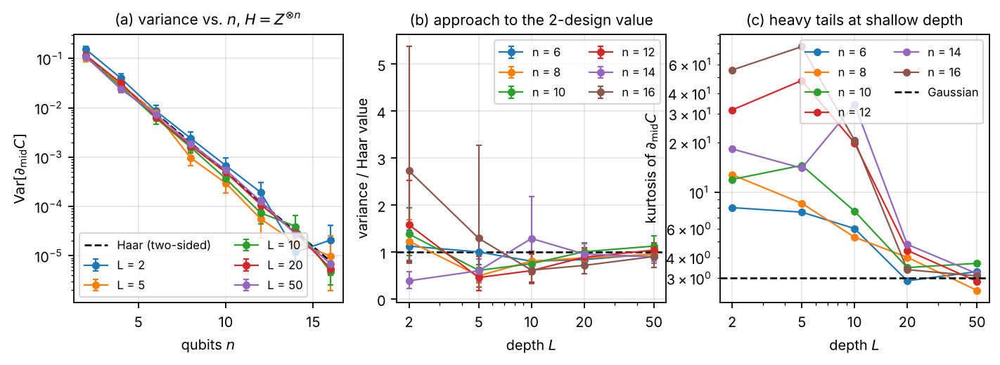
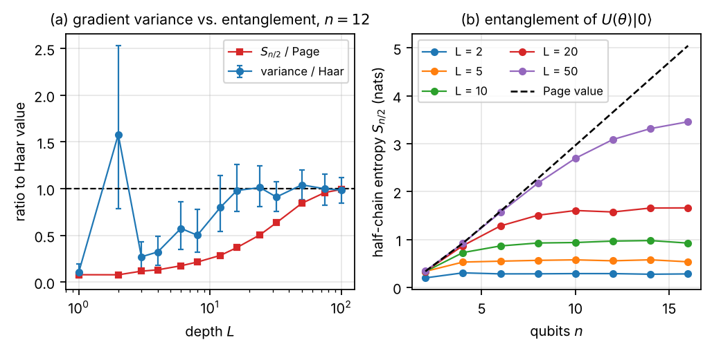
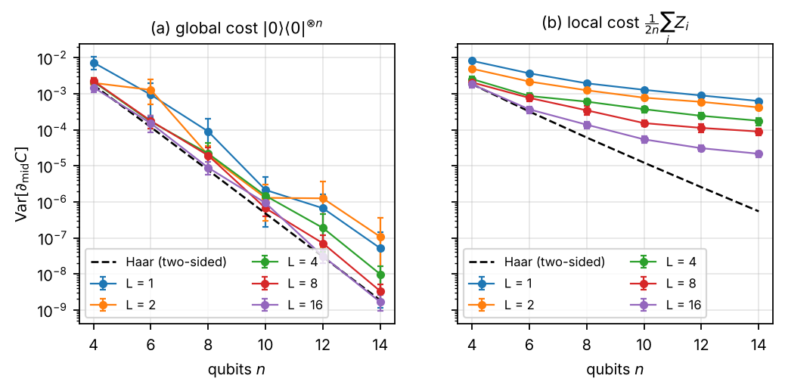
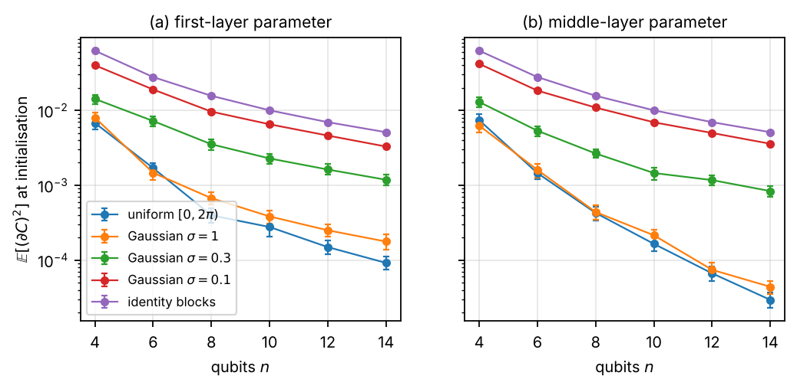
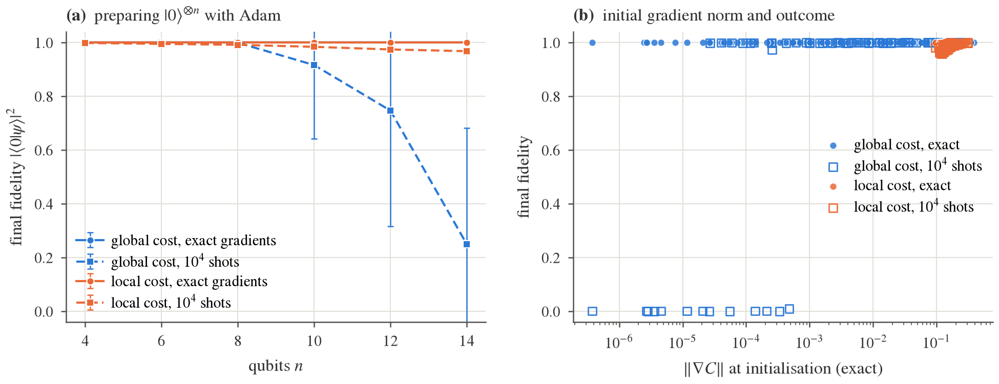
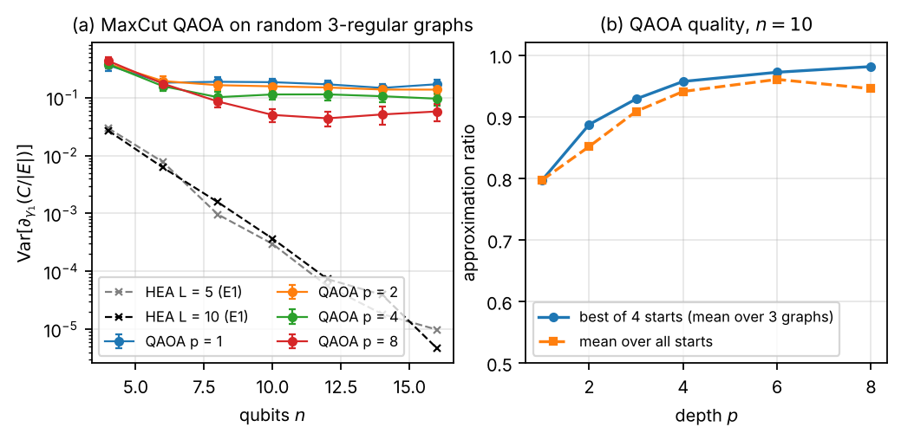
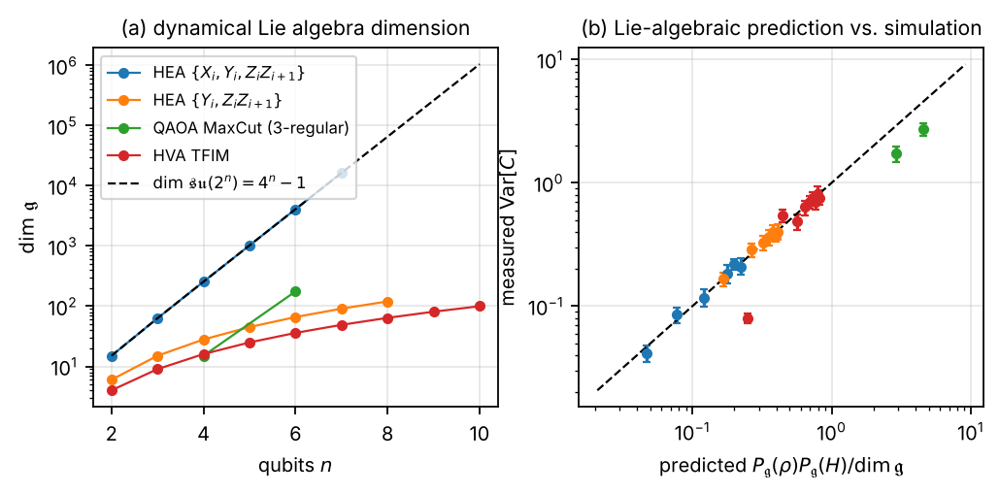

# Barren Plateaus from Scratch

*A NumPy State-Vector Study of Trainability in Variational Quantum Circuits*

**Thanatchon Chongmankhong**

> Markdown mirror of `paper/main.tex`, generated by `paper/md_mirror.py` (do not edit). The PDF (`paper/paper.pdf`) is authoritative; equations render best there or in the [web version](https://thanatchon36.github.io/bp-from-scratch/paper/).

# Abstract

Barren plateaus — gradients whose variance vanishes exponentially in the number of qubits — are the central obstacle to training variational quantum circuits. We present a small, fully auditable state-vector simulator written in NumPy (about 500 lines, exact adjoint gradients, validated against independent references and PennyLane) and use it to reproduce and extend the main results of the barren-plateau literature on $`2`$–$`16`$ qubits. We derive closed-form Haar (unitary 2-design) values for the gradient variance with the circuit before and/or after a rotation drawn at random, and verify them numerically to within sampling error. With these references we measure how a hardware-efficient ansatz approaches the 2-design value as a function of depth and find that (i) the approach is non-monotonic, (ii) the gradient distribution is strongly heavy-tailed at shallow depth (kurtosis up to $`\sim 80`$) and becomes Gaussian only where the variance saturates, and (iii) the variance saturates at a depth where the half-chain entanglement entropy of the output state is still less than half of the Page value. We confirm the cost-function dependence of Cerezo et al. (global costs decay as $`4^{-n}`$, local costs much more slowly), compare small-angle and identity-block initialisations, and show that with exact gradients Adam prepares $`|0\rangle^{\otimes n}`$ through a global cost even at $`n=14`$ where $`\|\nabla C\|\approx 10^{-4}`$, whereas with $`10^4`$-shot gradient noise the same optimisation fails progressively beyond $`n=10`$ while the local cost keeps succeeding. QAOA for MaxCut on random 3-regular graphs shows no plateau at fixed depth. Finally, we compute dynamical Lie algebras (DLAs) exactly for four ansatz families and test the Lie-algebraic prediction $`\mathrm{Var}[C]=\mathcal P_\mathfrak{g}(\rho)\mathcal P_\mathfrak{g}(H)/\dim\mathfrak{g}`$ of Ragone et al.: it holds to within 10% for the three families that reach the 2-design regime, including a hardware-efficient family whose DLA turns out to be $`\mathfrak{so}(2n)`$, of polynomial dimension $`n(2n-1)`$. Every figure in this report is regenerated by a single script.

# Introduction

Variational quantum algorithms (VQAs) optimise the parameters $`\theta`$ of a quantum circuit $`U(\theta)`$ to minimise a cost $`C(\theta)=\langle 0|U(\theta)^\dagger H U(\theta)|0\rangle`$. McClean et al. \[[1](#ref-mcclean2018)\] showed that for circuits that are random enough to form unitary 2-designs, the gradient of $`C`$ has mean zero and a variance that shrinks exponentially with the number of qubits $`n`$ — a *barren plateau* (BP). A large literature has since characterised when plateaus occur: they depend on the locality of the cost \[[2](#ref-cerezo2021)\], on the entanglement of the states the ansatz produces \[[3](#ref-ortiz2021)\], on how parameters are initialised \[[4](#ref-grant2019), [5](#ref-zhang2022)\], and, most generally, on the dimension of the dynamical Lie algebra (DLA) generated by the circuit \[[6](#ref-larocca2022), [7](#ref-ragone2024), [8](#ref-fontana2024)\]; see \[[9](#ref-larocca2025)\] for a review.

These results are precise and quantitative, and most of them can be tested on $`2`$–$`16`$ qubits with a few hundred thousand cheap gradient evaluations. This report does exactly that, with two goals. The first is pedagogical and engineering-oriented: a transparent simulator with exact analytic gradients that fits in a few hundred lines, is verified against independent references and against an established library, and runs every experiment reported here on a single CPU core in under an hour. The second is scientific: to put the main theoretical predictions side by side with controlled numerics and to report the quantitative discrepancies and non-obvious behaviours that appear in the process.

#### Contributions.

1.  **Simulator.** A NumPy state-vector simulator (`qsim`) with in-place gate application, fast paths for diagonal and controlled gates, parameter-shift and adjoint-mode gradients supporting shared and scaled parameters (Sec. <a href="#sec:sim" data-reference-type="ref" data-reference="sec:sim">3</a>). It is 2–8$`\times`$ faster than PennyLane’s `default.qubit` for the circuits used here, and returns the full gradient of 320 parameters at $`n=16`$ in $`0.66`$ s.

2.  **Closed-form references.** Haar-average gradient variances for a rotation with a 2-design before, after, or on both sides (Appendix <a href="#app:haar" data-reference-type="ref" data-reference="app:haar">8</a>), verified numerically (Table <a href="#tab:haar" data-reference-type="ref" data-reference="tab:haar">5</a>).

3.  **Approach to the plateau.** The variance of a hardware-efficient ansatz converges to the two-sided Haar value non-monotonically with depth; the gradient distribution is heavy-tailed until it does; and the variance saturates long before the output entanglement does (Secs. <a href="#sec:e1" data-reference-type="ref" data-reference="sec:e1">5.1</a>–<a href="#sec:e4" data-reference-type="ref" data-reference="sec:e4">5.2</a>).

4.  **Reproductions with quantified discrepancies.** Cost locality (Sec. <a href="#sec:e2" data-reference-type="ref" data-reference="sec:e2">5.3</a>), initialisation strategies (Sec. <a href="#sec:e3" data-reference-type="ref" data-reference="sec:e3">5.4</a>), QAOA (Sec. <a href="#sec:e6" data-reference-type="ref" data-reference="sec:e6">5.6</a>).

5.  **Plateaus versus optimisation.** With exact gradients Adam is insensitive to the plateau at these sizes; with realistic shot noise it is not (Sec. <a href="#sec:e5" data-reference-type="ref" data-reference="sec:e5">5.5</a>).

6.  **Lie-algebraic check.** Exact DLA dimensions and $`\mathfrak{g}`$-purities for four ansatz families, compared with the variance of deep circuits (Sec. <a href="#sec:e7" data-reference-type="ref" data-reference="sec:e7">5.7</a>).

# Background and conventions

A parameterised circuit is a product $`U(\theta)=U_M\cdots U_1`$ of fixed gates and rotations $`U_k=\exp(-i\,a_k G_k/2)`$ with Hermitian, involutory generators ($`G_k^2=\mathbb 1`$: Pauli strings). The angle $`a_k`$ is either fixed or $`a_k=s_k\theta_{p(k)}`$, so that one parameter may drive several gates (as in QAOA) with a scale $`s_k`$. Qubit $`0`$ is the most significant bit and rotations follow the $`\exp(-iaG/2)`$ convention of PennyLane and Qiskit. Because every generator is involutory, $`C`$ is a sinusoid in every gate angle and the *parameter-shift rule* is exact, <span id="eq:pshift"></span>
``` math
\begin{equation}
  \frac{\partial C}{\partial a_k} = \tfrac12\big[C(a_k+\tfrac\pi2)-C(a_k-\tfrac\pi2)\big].\qquad\text{(1)}
\end{equation}
```
In simulation the whole gradient is obtained with $`O(M)`$ state-vector operations by the adjoint method \[[10](#ref-jones2020)\] (Appendix <a href="#app:adjoint" data-reference-type="ref" data-reference="app:adjoint">9</a>).

#### Barren plateaus.

For a rotation $`U_k`$ write $`U(\theta)=U_L U_k U_R`$. If $`U_L`$ and $`U_R`$ are independent unitary 2-designs, $`\mathbb{E}[\partial_k C]=0`$ and, as derived in Appendix <a href="#app:haar" data-reference-type="ref" data-reference="app:haar">8</a>, <span id="eq:haar2"></span>
``` math
\begin{equation}
  \mathrm{Var}[\partial_k C] = \frac{d\,\mathrm{Tr}H^2-(\mathrm{Tr}H)^2}{2(d+1)^2(d-1)},\qquad d=2^n .\qquad\text{(2)}
\end{equation}
```
For a traceless Pauli string $`H`$ this is $`\approx 1/(2d)=2^{-n}/2`$; for the projector $`H=|0\rangle\langle0|^{\otimes n}`$ it is $`\approx 4^{-n}/2`$. If only one side is a 2-design the variance is still $`O(2^{-n})`$ \[[1](#ref-mcclean2018)\]; the exact one-sided values are Eqs. ([7](#eq:haarL))–([8](#eq:haarR)). Cerezo et al. \[[2](#ref-cerezo2021)\] proved for alternating-layered ansätze that a *global* cost (an operator acting non-trivially on all qubits) has exponentially small gradients at any depth, while a *local* cost (a sum of few-body terms) has gradients bounded below by $`1/\mathrm{poly}(n)`$ for depth $`L\in O(\log n)`$. Ortiz Marrero et al. \[[3](#ref-ortiz2021)\] connected plateaus to the entanglement between the measured and unmeasured qubits. Grant et al. \[[4](#ref-grant2019)\] proposed initialising in blocks that compose to the identity, and Zhang et al. \[[5](#ref-zhang2022)\] proposed small-angle Gaussian initialisations. Finally, the Lie-algebraic theory \[[6](#ref-larocca2022), [7](#ref-ragone2024), [8](#ref-fontana2024)\] states that for deep circuits (a 2-design on $`e^{\mathfrak{g}}`$) and $`\rho`$ or $`H`$ in $`i\mathfrak{g}`$, <span id="eq:dla"></span>
``` math
\begin{equation}
  \mathrm{Var}[C]=\frac{\mathcal P_\mathfrak{g}(\rho)\,\mathcal P_\mathfrak{g}(H)}{\dim\mathfrak{g}},\qquad \mathcal P_\mathfrak{g}(X)=\|X_\mathfrak{g}\|_F^2,\qquad\text{(3)}
\end{equation}
```
where $`X_\mathfrak{g}`$ is the orthogonal projection of $`X`$ onto the DLA $`\mathfrak{g}`$; for $`\mathfrak{g}=\mathfrak{su}(d)`$ Eq. ([3](#eq:dla)) reduces to the Haar value $`\mathrm{Var}[C]=\mathrm{Tr}H^2/(d(d+1))`$ for traceless $`H`$.

# The simulator

#### Representation.

The state is a flat, contiguous `complex128` array of $`2^n`$ amplitudes. A single-qubit gate on qubit $`q`$ is applied by viewing the array as a $`(2^q,2,2^{n-q-1})`$ tensor and combining the two slices along the middle axis; a two-qubit gate uses a $`(2^\mathrm{lo},2,\cdot,2,2^{n-\mathrm{hi}-1})`$ view and the four slices indexed by the two qubit bits. No $`2^n\times 2^n`$ matrix is ever formed. Diagonal gates multiply slices in place; CNOT and CZ are a slice swap and a sign flip. A generic $`k`$-qubit gate falls back to `tensordot`. Pauli strings are applied letter by letter, which makes Pauli-sum expectation values and $`H|\psi\rangle`$ cheap.

#### Gradients.

`qsim` implements Eq. ([1](#eq:pshift)) (shifting one gate occurrence at a time, so shared parameters are handled by summation) and the adjoint method. Both are checked against central finite differences on circuits with shared and scaled parameters, fixed gates, and generic two-qubit unitaries; they agree to $`10^{-10}`$.

#### Verification.

Fifty-eight tests compare gate application with an independent `tensordot`/`moveaxis` implementation and with Kronecker-product matrices, check Bell/GHZ states, Pauli-sum operators against dense matrices, entanglement entropies against Bell/GHZ/Page values, the Pauli algebra used for DLAs against matrix products, and — when PennyLane is installed — states, expectation values and parameter-shift gradients of a 13-parameter circuit against `default.qubit` (agreement to $`10^{-8}`$).

#### Performance.

Table <a href="#tab:bench" data-reference-type="ref" data-reference="tab:bench">1</a> lists wall-clock times on one CPU core for a hardware-efficient ansatz (RY, RZ on every qubit and a CNOT ladder, $`L=10`$). The adjoint gradient costs $`\approx 4`$–$`5`$ forward passes independently of the number of parameters; the parameter-shift gradient costs $`2P`$ forward passes and is only used for cross-checks.

<div id="tab:bench">

<table>
<caption>Forward pass of a 10-layer hardware-efficient ansatz (<span class="math inline">2<em>n</em><em>L</em></span> parameters) and its full gradient; PennyLane 0.45 forward passes for the same circuit. Single core, NumPy 2.5, Python 3.12. <code>lightning.qubit</code> is a compiled C++ backend.</caption>
<tbody>
<tr>
<td style="text-align: center;"></td>
<td colspan="3" style="text-align: center;"><code>qsim</code></td>
<td colspan="2" style="text-align: center;">PennyLane, forward pass</td>
</tr>
<tr>
<td style="text-align: center;"><span class="math inline"><em>n</em></span></td>
<td style="text-align: right;">forward</td>
<td style="text-align: right;">adjoint gradient</td>
<td style="text-align: right;">parameter shift</td>
<td style="text-align: right;"><code>default.qubit</code></td>
<td style="text-align: right;"><code>lightning.qubit</code></td>
</tr>
<tr>
<td style="text-align: center;">8</td>
<td style="text-align: right;">2.5 ms</td>
<td style="text-align: right;">11 ms</td>
<td style="text-align: right;">0.83 s</td>
<td style="text-align: right;">19 ms</td>
<td style="text-align: right;">9 ms</td>
</tr>
<tr>
<td style="text-align: center;">12</td>
<td style="text-align: right;">9.3 ms</td>
<td style="text-align: right;">34 ms</td>
<td style="text-align: right;">–</td>
<td style="text-align: right;">35 ms</td>
<td style="text-align: right;">15 ms</td>
</tr>
<tr>
<td style="text-align: center;">16</td>
<td style="text-align: right;">0.13 s</td>
<td style="text-align: right;">0.66 s</td>
<td style="text-align: right;">–</td>
<td style="text-align: right;">0.28 s</td>
<td style="text-align: right;">0.035 s</td>
</tr>
<tr>
<td style="text-align: center;">18</td>
<td style="text-align: right;">0.48 s</td>
<td style="text-align: right;">4.2 s</td>
<td style="text-align: right;">–</td>
<td style="text-align: right;">1.3 s</td>
<td style="text-align: right;">0.11 s</td>
</tr>
</tbody>
</table>

</div>

# Experimental protocol

#### Ansätze.

\(i\) The random circuit of McClean et al. \[[1](#ref-mcclean2018)\] (“McClean HEA”): a fixed layer of $`R_Y(\pi/4)`$, then $`L`$ layers each consisting of one rotation per qubit about an axis drawn uniformly from $`\{X,Y,Z\}`$ and a CZ ladder on the open chain; the axes are redrawn for every sample. (ii) The RY–RZ hardware-efficient ansatz: $`R_Y`$ and $`R_Z`$ on every qubit followed by a CZ ladder (“RY–RZ HEA”) or by CZs in a brick pattern (“ALA”, the alternating-layered ansatz of \[[2](#ref-cerezo2021)\]). (iii) Identity blocks \[[4](#ref-grant2019)\]: $`M`$ blocks $`B(\theta')A(\theta)`$ with $`A=[R_YR_Z]\,\mathrm{CZ}\,[R_YR_Z]`$, $`B=A^\dagger`$ at initialisation. (iv) QAOA for MaxCut \[[12](#ref-farhi2014)\]: $`|+\rangle^{\otimes n}`$ followed by $`p`$ layers of $`e^{-i\gamma\sum_E Z_iZ_j}e^{-i\beta\sum_i X_i}`$. (v) Fully parameterised Pauli-rotation circuits for the DLA study (Sec. <a href="#sec:e7" data-reference-type="ref" data-reference="sec:e7">5.7</a>).

#### Costs.

$`H=Z^{\otimes n}`$ (global, traceless); $`|0\rangle\langle0|^{\otimes n}`$ (global projector); $`\tfrac{1}{2n}\sum_iZ_i`$ and $`\tfrac1n\sum_iX_i`$ (local); the cut operator $`\sum_{(i,j)\in E}\tfrac12(1-Z_iZ_j)`$; and the chain $`\sum_iZ_iZ_{i+1}`$.

#### Statistics.

For every configuration we draw $`N`$ random parameter vectors (uniform on $`[0,2\pi)`$ unless stated) and compute the full gradient. We report the variance of the derivative with respect to a *probe* parameter in the middle layer and middle qubit ($`\partial_\mathrm{mid}`$), which has random circuit on both sides, and sometimes of the first-layer parameter ($`\partial_\mathrm{first}`$). Error bars are 95% percentile-bootstrap intervals of the variance (400 resamples). Decay exponents are least-squares slopes of $`\log_2\mathrm{Var}`$ against $`n`$ over $`n\ge6`$. $`N=300`$ for $`n\le14`$ in E1 and E4, $`N=200`$ for $`n=16`$ ($`N=100`$ for $`L\ge20`$ at $`n=16`$), $`N=200`$ in E2, E3, E6 and $`N=400`$ forward passes in E7. All seeds are fixed; `make results` regenerates every number in this report.

# Results

## E1: approach to the two-sided Haar value

<figure id="fig:e1" data-latex-placement="t">

<figcaption>McClean HEA, <span class="math inline"><em>H</em> = <em>Z</em><sup>⊗<em>n</em></sup></span>. (a) Variance of the middle-layer derivative versus <span class="math inline"><em>n</em></span> for depths <span class="math inline"><em>L</em> = 2</span>–<span class="math inline">50</span>; the dashed line is Eq. (<a href="#eq:haar2">2</a>). (b) The same data divided by Eq. (<a href="#eq:haar2">2</a>), versus depth. (c) Kurtosis <span class="math inline">𝔼[<em>g</em><sup>4</sup>]/𝔼[<em>g</em><sup>2</sup>]<sup>2</sup></span> of the same derivative; a Gaussian has kurtosis 3.</figcaption>
</figure>

<div id="tab:slopes">

<table>
<caption>E1: fitted decay exponents of <span class="math inline">log<sub>2</sub>Var</span> versus <span class="math inline"><em>n</em></span> (<span class="math inline"><em>n</em> ≥ 6</span>) for the middle-layer derivative and for the variance averaged over all parameters; the ratio of the measured variance to the two-sided Haar value and the kurtosis of the middle-layer derivative, both at <span class="math inline"><em>n</em> = 16</span>.</caption>
<tbody>
<tr>
<td style="text-align: center;"></td>
<td colspan="2" style="text-align: center;">decay exponent of <span class="math inline">log<sub>2</sub>Var</span></td>
<td colspan="2" style="text-align: center;">at <span class="math inline"><em>n</em> = 16</span></td>
</tr>
<tr>
<td style="text-align: center;">depth <span class="math inline"><em>L</em></span></td>
<td style="text-align: center;"><span class="math inline">∂<sub>mid</sub><em>C</em></span></td>
<td style="text-align: center;">mean over parameters</td>
<td style="text-align: center;">Var/Haar</td>
<td style="text-align: center;">kurtosis</td>
</tr>
<tr>
<td style="text-align: center;">2</td>
<td style="text-align: center;"><span class="math inline">−0.98</span></td>
<td style="text-align: center;"><span class="math inline">−0.97</span></td>
<td style="text-align: center;"><span class="math inline">2.73</span></td>
<td style="text-align: center;"><span class="math inline">55.4</span></td>
</tr>
<tr>
<td style="text-align: center;">5</td>
<td style="text-align: center;"><span class="math inline">−0.97</span></td>
<td style="text-align: center;"><span class="math inline">−1.02</span></td>
<td style="text-align: center;"><span class="math inline">1.29</span></td>
<td style="text-align: center;"><span class="math inline">76.8</span></td>
</tr>
<tr>
<td style="text-align: center;">10</td>
<td style="text-align: center;"><span class="math inline">−1.00</span></td>
<td style="text-align: center;"><span class="math inline">−1.05</span></td>
<td style="text-align: center;"><span class="math inline">0.62</span></td>
<td style="text-align: center;"><span class="math inline">20.6</span></td>
</tr>
<tr>
<td style="text-align: center;">20</td>
<td style="text-align: center;"><span class="math inline">−1.01</span></td>
<td style="text-align: center;"><span class="math inline">−1.00</span></td>
<td style="text-align: center;"><span class="math inline">0.71</span></td>
<td style="text-align: center;"><span class="math inline">3.4</span></td>
</tr>
<tr>
<td style="text-align: center;">50</td>
<td style="text-align: center;"><span class="math inline">−1.01</span></td>
<td style="text-align: center;"><span class="math inline">−1.00</span></td>
<td style="text-align: center;"><span class="math inline">0.90</span></td>
<td style="text-align: center;"><span class="math inline">3.1</span></td>
</tr>
<tr>
<td style="text-align: center;">Haar (two-sided)</td>
<td style="text-align: center;"><span class="math inline">−0.99</span></td>
<td style="text-align: center;">–</td>
<td style="text-align: center;">1</td>
<td style="text-align: center;">3</td>
</tr>
</tbody>
</table>

</div>

Figure <a href="#fig:e1" data-reference-type="ref" data-reference="fig:e1">1</a>(a) shows the classic picture: at every depth the variance decays as $`2^{-n}`$ — the fitted exponents in Table <a href="#tab:slopes" data-reference-type="ref" data-reference="tab:slopes">2</a> lie between $`-0.97`$ and $`-1.01`$, against $`-0.99`$ for Eq. ([2](#eq:haar2)) — and the deepest circuits sit on the two-sided Haar prediction (at $`L=50`$ the ratio to Eq. ([2](#eq:haar2)) is $`0.95`$, $`1.13`$, $`1.04`$, $`0.90`$, $`0.90`$ for $`n=8,10,12,14,16`$). Three features are less familiar.

*Non-monotonic approach.* Panel (b) shows that the ratio to the Haar value does not decrease monotonically from above. At $`L=2`$ the probe sits in the last layer, where one third of the rotations are about $`Z`$ and commute with $`H`$, so the derivative vanishes exactly for one third of the samples; the remaining samples are large, and the variance exceeds the Haar value. At $`L=5`$ and $`L=10`$ the variance *undershoots* the Haar value by a factor of $`\approx 1.5`$–$`2`$ for $`n\ge 10`$ (e.g. $`0.46`$ at $`n=12`$, $`L=5`$; $`0.60`$ at $`n=14`$, $`L=5`$), and then converges from below between $`L=20`$ and $`L=50`$. Nothing forbids this: an ensemble that is not a 2-design may have a second moment smaller or larger than Haar’s, and the shallow McClean ensemble, with its $`Z`$-rotations that commute with the CZ ladder, is less random than its gate count suggests.

*Heavy tails.* Panel (c) is, to our knowledge, not usually shown: at shallow depth the derivative distribution has kurtosis 20–80 (and an atom at zero), so variance estimates from a few hundred samples carry wide confidence intervals, which the error bars in (a,b) reflect. The kurtosis drops to the Gaussian value 3 between $`L=10`$ and $`L=20`$ for $`n\ge10`$ — exactly where the variance reaches its plateau — and it does so earlier for larger $`n`$. Kurtosis is therefore a convenient, essentially free diagnostic of whether a circuit ensemble has reached the 2-design regime.

*Per-position dependence.* The variance of the first- and last-layer derivatives differs from the middle one by $`O(1)`$ factors that are predicted by the one-sided formulas of Appendix <a href="#app:haar" data-reference-type="ref" data-reference="app:haar">8</a> (e.g. $`\mathrm{Var}[\partial_\mathrm{last}C]\to\tfrac{2}{3}\,(d+1)^{-1}`$ for the random-axis ensemble, because the $`Z`$-axis samples contribute zero), while the exponent is the same.

## E4: gradient variance saturates before entanglement does

<figure id="fig:e4" data-latex-placement="t">

<figcaption>(a) McClean HEA at <span class="math inline"><em>n</em> = 12</span> on a fine depth grid: variance of <span class="math inline">∂<sub>mid</sub><em>C</em></span> divided by Eq. (<a href="#eq:haar2">2</a>), and half-chain entanglement entropy of <span class="math inline"><em>U</em>(<em>θ</em>)|0⟩</span> divided by the Page value <span class="math inline"><em>S</em><sub>Page</sub> = 3.66</span> nats. (b) Half-chain entropy versus <span class="math inline"><em>n</em></span> for the depths of E1; the dashed line is the exact Page value [<a href="#ref-page1993">11</a>].</figcaption>
</figure>

Entanglement-induced plateaus \[[3](#ref-ortiz2021)\] suggest looking at the two quantities together. Figure <a href="#fig:e4" data-reference-type="ref" data-reference="fig:e4">2</a>(a) shows, at $`n=12`$, that the variance is statistically indistinguishable from the Haar value from $`L\approx16`$–$`24`$ onwards (ratios $`0.98`$, $`1.01`$, $`0.91`$, $`1.04`$, $`1.00`$ at $`L=16,24,32,50,75`$), whereas the half-chain entropy at $`L=16`$ is only $`1.35`$ nats, 37% of the Page value, and reaches 96% of it only at $`L=75`$ (99% at $`L=100`$, where the variance ratio is $`0.99`$). Panel (b) shows the same across $`n`$: at $`L=10`$ the entropy is far from Page for every $`n\ge8`$ while the variance already decays as $`2^{-n}`$. The gradient of a *global* cost thus sees “enough” randomness much earlier than the bipartite entanglement does; the second moment of the ensemble converges faster than its Page-curve statistics. Conversely, large entanglement is not needed for a plateau in this cost.

## E2: cost-function dependence

<figure id="fig:e2" data-latex-placement="t">

<figcaption>ALA (RY–RZ rotations, CZ bricks). Variance of the middle-layer derivative for (a) the global projector cost and (b) the local cost, versus <span class="math inline"><em>n</em></span> for depths <span class="math inline"><em>L</em> = 1</span>–<span class="math inline">16</span>. Dashed: two-sided Haar values, Eq. (<a href="#eq:haar2">2</a>), for each operator.</figcaption>
</figure>

Figure <a href="#fig:e2" data-reference-type="ref" data-reference="fig:e2">3</a> reproduces the central result of \[[2](#ref-cerezo2021)\]. For the projector cost the fitted exponents are $`-1.6`$ to $`-2.1`$ (approaching the $`4^{-n}`$ Haar scaling with depth), and already at $`L=1`$ the variance is $`5\times10^{-8}`$ at $`n=14`$. For the local cost the exponents are $`-0.29`$ to $`-0.52`$: the decay is far slower than $`2^{-n}`$ at all depths studied and the variance at $`n=14`$, $`L=16`$ is $`2.2\times10^{-5}`$, four orders of magnitude above the global cost at the same size. The local-cost variance also lies well above its own Haar value (dashed) at every depth, i.e. these brick circuits are far from 2-designs for a local observable even at $`L=16`$; the slow drift of the local exponent with $`L`$ is consistent with the $`O(\log n)`$-depth window of \[[2](#ref-cerezo2021)\].

## E3: initialisation strategies

<figure id="fig:e3" data-latex-placement="t">

<figcaption>RY–RZ HEA with 20 CZ layers, local cost <span class="math inline">$\tfrac1n\sum_iX_i$</span>. Mean-square derivative <span class="math inline">𝔼[(∂<em>C</em>)<sup>2</sup>]</span> at initialisation for (a) the first-layer and (b) the middle-layer parameter, for uniform angles, Gaussian angles of width <span class="math inline"><em>σ</em></span>, and the identity-block construction (10 blocks).</figcaption>
</figure>

We report the mean square rather than the variance because the identity-block initialisation gives a *deterministic* first-layer derivative: with every block equal to the identity, $`B\,\partial_aA=A_1^\dagger\partial_aA_1`$ for a gate in the first half-layer, so $`\partial_aC=1/n`$ exactly for every random draw (variance zero, magnitude $`1/n`$). Figure <a href="#fig:e3" data-reference-type="ref" data-reference="fig:e3">4</a> shows that small-angle initialisations help as advertised \[[5](#ref-zhang2022)\]: at $`n=14`$ the mean-square first-layer derivative is $`9\times10^{-5}`$ for uniform angles, $`1.8\times10^{-4}`$ for $`\sigma=0.1`$ and $`1.2\times10^{-3}`$ for $`\sigma=0.3`$, with fitted exponents $`-0.60`$ (uniform), $`-0.51`$ ($`\sigma=1`$), $`-0.36`$ ($`\sigma=0.3`$) and $`-0.35`$ ($`\sigma=0.1`$). The identity-block curve decays as $`1/n^2`$ by construction. Two caveats: with this local cost and $`L=20`$ even the uniform initialisation decays with an exponent well above $`-1`$ (cf. Sec. <a href="#sec:e2" data-reference-type="ref" data-reference="sec:e2">5.3</a>), and a large gradient at $`\theta=0`$ says nothing about the landscape a few steps later, which is the regime that matters \[[9](#ref-larocca2025)\].

## E5: plateaus versus optimisation

<figure id="fig:e5" data-latex-placement="t">

<figcaption>Preparing <span class="math inline">|0⟩<sup>⊗<em>n</em></sup></span> with a 4-layer ALA and Adam (250 steps, learning rate 0.05) from uniformly random angles. (a) Final fidelity (mean <span class="math inline">±</span> s.d. over seeds) for the global and local cost, with exact gradients and with Gaussian “shot noise” of standard deviation <span class="math inline">(2 × 10<sup>4</sup>)<sup>−1/2</sup></span> added to every cost and gradient entry. (b) Every run: exact initial gradient norm versus final fidelity.</figcaption>
</figure>

<div id="tab:training">

<table>
<caption>E5 summary. 16 seeds for exact gradients (10 for the local cost at <span class="math inline"><em>n</em> = 14</span>), 12 seeds with shot noise.</caption>
<thead>
<tr>
<th style="text-align: left;"><span class="math inline"><em>n</em></span></th>
<th style="text-align: center;">4</th>
<th style="text-align: center;">6</th>
<th style="text-align: center;">8</th>
<th style="text-align: center;">10</th>
<th style="text-align: center;">12</th>
<th style="text-align: center;">14</th>
</tr>
</thead>
<tbody>
<tr>
<td colspan="7" style="text-align: left;"><em>global cost, exact gradients</em></td>
</tr>
<tr>
<td style="text-align: left;">  mean fidelity</td>
<td style="text-align: center;">1.000</td>
<td style="text-align: center;">1.000</td>
<td style="text-align: center;">1.000</td>
<td style="text-align: center;">1.000</td>
<td style="text-align: center;">1.000</td>
<td style="text-align: center;">1.000</td>
</tr>
<tr>
<td style="text-align: left;">  fraction with <span class="math inline"><em>F</em> &gt; 0.9</span></td>
<td style="text-align: center;">1.00</td>
<td style="text-align: center;">1.00</td>
<td style="text-align: center;">1.00</td>
<td style="text-align: center;">1.00</td>
<td style="text-align: center;">1.00</td>
<td style="text-align: center;">1.00</td>
</tr>
<tr>
<td style="text-align: left;">  mean <span class="math inline">∥∇<em>C</em>∥</span> at initialisation</td>
<td style="text-align: center;">0.16</td>
<td style="text-align: center;">0.046</td>
<td style="text-align: center;">0.028</td>
<td style="text-align: center;">0.0045</td>
<td style="text-align: center;">0.0022</td>
<td style="text-align: center;">0.00015</td>
</tr>
<tr>
<td colspan="7" style="text-align: left;"><em>local cost, exact gradients</em></td>
</tr>
<tr>
<td style="text-align: left;">  mean fidelity</td>
<td style="text-align: center;">1.000</td>
<td style="text-align: center;">1.000</td>
<td style="text-align: center;">1.000</td>
<td style="text-align: center;">1.000</td>
<td style="text-align: center;">1.000</td>
<td style="text-align: center;">1.000</td>
</tr>
<tr>
<td style="text-align: left;">  fraction with <span class="math inline"><em>F</em> &gt; 0.9</span></td>
<td style="text-align: center;">1.00</td>
<td style="text-align: center;">1.00</td>
<td style="text-align: center;">1.00</td>
<td style="text-align: center;">1.00</td>
<td style="text-align: center;">1.00</td>
<td style="text-align: center;">1.00</td>
</tr>
<tr>
<td style="text-align: left;">  mean <span class="math inline">∥∇<em>C</em>∥</span> at initialisation</td>
<td style="text-align: center;">0.24</td>
<td style="text-align: center;">0.19</td>
<td style="text-align: center;">0.16</td>
<td style="text-align: center;">0.14</td>
<td style="text-align: center;">0.13</td>
<td style="text-align: center;">0.12</td>
</tr>
<tr>
<td colspan="7" style="text-align: left;"><em>global cost, <span class="math inline">10<sup>4</sup></span> shots</em></td>
</tr>
<tr>
<td style="text-align: left;">  mean fidelity</td>
<td style="text-align: center;">0.999</td>
<td style="text-align: center;">0.999</td>
<td style="text-align: center;">0.999</td>
<td style="text-align: center;">0.916</td>
<td style="text-align: center;">0.746</td>
<td style="text-align: center;">0.250</td>
</tr>
<tr>
<td style="text-align: left;">  fraction with <span class="math inline"><em>F</em> &gt; 0.9</span></td>
<td style="text-align: center;">1.00</td>
<td style="text-align: center;">1.00</td>
<td style="text-align: center;">1.00</td>
<td style="text-align: center;">0.92</td>
<td style="text-align: center;">0.75</td>
<td style="text-align: center;">0.25</td>
</tr>
<tr>
<td colspan="7" style="text-align: left;"><em>local cost, <span class="math inline">10<sup>4</sup></span> shots</em></td>
</tr>
<tr>
<td style="text-align: left;">  mean fidelity</td>
<td style="text-align: center;">0.998</td>
<td style="text-align: center;">0.994</td>
<td style="text-align: center;">0.991</td>
<td style="text-align: center;">0.984</td>
<td style="text-align: center;">0.974</td>
<td style="text-align: center;">0.967</td>
</tr>
<tr>
<td style="text-align: left;">  fraction with <span class="math inline"><em>F</em> &gt; 0.9</span></td>
<td style="text-align: center;">1.00</td>
<td style="text-align: center;">1.00</td>
<td style="text-align: center;">1.00</td>
<td style="text-align: center;">1.00</td>
<td style="text-align: center;">1.00</td>
<td style="text-align: center;">1.00</td>
</tr>
</tbody>
</table>

</div>

A plateau at initialisation does not by itself prevent a classical simulation from training. With exact gradients, Adam — whose update is approximately scale-invariant — reaches fidelity $`>0.9999`$ for *both* costs at every $`n\le14`$, including the global cost at $`n=14`$ where the initial gradient norm is $`1.5\times10^{-4}`$ (Table <a href="#tab:training" data-reference-type="ref" data-reference="tab:training">3</a>, Fig. <a href="#fig:e5" data-reference-type="ref" data-reference="fig:e5">5</a>). The plateau becomes an obstacle when gradients must be *estimated*: adding Gaussian noise equivalent to $`10^4`$ shots per expectation value, the global-cost optimisation degrades from mean fidelity $`0.999`$ ($`n\le8`$) to $`0.92`$ ($`n=10`$), $`0.75`$ ($`n=12`$) and $`0.25`$ ($`n=14`$), while the local cost stays at $`0.97`$–$`0.998`$ with every run above $`0.9`$. Panel (b) makes the mechanism explicit: failures occur exactly for the runs whose exact initial gradient norm lies below the noise level $`\sigma\sqrt{P}`$. In other words, the operational content of a barren plateau is the exponential number of measurements needed to resolve the gradient, not an intrinsic failure of gradient descent.

## E6: a problem-inspired ansatz — QAOA for MaxCut

<figure id="fig:e6" data-latex-placement="t">

<figcaption>(a) Variance of <span class="math inline">∂<em>C</em>/∂<em>γ</em><sub>1</sub></span> for QAOA on random 3-regular graphs (new graph and parameters for every sample; cost normalised by <span class="math inline">|<em>E</em>| = 3<em>n</em>/2</span>) versus <span class="math inline"><em>n</em></span> for depths <span class="math inline"><em>p</em> = 1</span>–<span class="math inline">8</span>, compared with the McClean HEA at <span class="math inline"><em>L</em> = 5</span> and <span class="math inline">10</span> from E1. (b) Approximation ratio reached by Adam (150 steps) at <span class="math inline"><em>n</em> = 10</span> versus <span class="math inline"><em>p</em></span>, for 3 graphs and 4 random starts each.</figcaption>
</figure>

For the HEA the normalised variance decays with exponent $`-1`$; for QAOA at fixed depth the fitted exponents are $`-0.02`$ ($`p=1`$), $`-0.05`$ ($`p=2`$ and $`4`$) and $`-0.15`$ ($`p=8`$): no plateau at fixed depth, consistent with the parameter-concentration results for QAOA and with its small DLA (Sec. <a href="#sec:e7" data-reference-type="ref" data-reference="sec:e7">5.7</a>). The price is expressivity: the approximation ratio at $`n=10`$ grows from $`0.80`$ at $`p=1`$ to $`0.96`$ at $`p=4`$ and $`0.98`$ at $`p=8`$ (best of four starts; the mean over starts saturates at $`0.95`$ because local optima appear at $`p=8`$).

## E7: dynamical Lie algebras

<figure id="fig:e7" data-latex-placement="t">

<figcaption>(a) Exact DLA dimension versus <span class="math inline"><em>n</em></span> for the four fully parameterised families; dashed: <span class="math inline">dim 𝔰𝔲(2<sup><em>n</em></sup>) = 4<sup><em>n</em></sup> − 1</span>. (b) Variance of the cost over uniformly random parameters of a 60-layer circuit (400 samples) versus the prediction of Eq. (<a href="#eq:dla">3</a>).</figcaption>
</figure>

<div id="tab:dla">

<table>
<caption>E7: DLA dimensions and the ratio of the measured to the predicted cost variance.</caption>
<thead>
<tr>
<th style="text-align: left;">family / <span class="math inline"><em>n</em></span></th>
<th style="text-align: center;">2</th>
<th style="text-align: center;">3</th>
<th style="text-align: center;">4</th>
<th style="text-align: center;">5</th>
<th style="text-align: center;">6</th>
<th style="text-align: center;">7</th>
<th style="text-align: center;">8</th>
<th style="text-align: center;">9</th>
<th style="text-align: center;">10</th>
</tr>
</thead>
<tbody>
<tr>
<td colspan="10" style="text-align: left;"><em>DLA dimension</em></td>
</tr>
<tr>
<td style="text-align: left;">  <span class="math inline">4<sup><em>n</em></sup> − 1</span></td>
<td style="text-align: center;">15</td>
<td style="text-align: center;">63</td>
<td style="text-align: center;">255</td>
<td style="text-align: center;">1023</td>
<td style="text-align: center;">4095</td>
<td style="text-align: center;">16383</td>
<td style="text-align: center;">65535</td>
<td style="text-align: center;">262143</td>
<td style="text-align: center;">1048575</td>
</tr>
<tr>
<td style="text-align: left;">  HEA <span class="math inline">{<em>X</em><sub><em>i</em></sub>, <em>Y</em><sub><em>i</em></sub>, <em>Z</em><sub><em>i</em></sub><em>Z</em><sub><em>i</em> + 1</sub>}</span></td>
<td style="text-align: center;">15</td>
<td style="text-align: center;">63</td>
<td style="text-align: center;">255</td>
<td style="text-align: center;">1023</td>
<td style="text-align: center;">4095</td>
<td style="text-align: center;">16383</td>
<td style="text-align: center;">–</td>
<td style="text-align: center;">–</td>
<td style="text-align: center;">–</td>
</tr>
<tr>
<td style="text-align: left;">  HEA <span class="math inline">{<em>Y</em><sub><em>i</em></sub>, <em>Z</em><sub><em>i</em></sub><em>Z</em><sub><em>i</em> + 1</sub>}</span></td>
<td style="text-align: center;">6</td>
<td style="text-align: center;">15</td>
<td style="text-align: center;">28</td>
<td style="text-align: center;">45</td>
<td style="text-align: center;">66</td>
<td style="text-align: center;">91</td>
<td style="text-align: center;">120</td>
<td style="text-align: center;">–</td>
<td style="text-align: center;">–</td>
</tr>
<tr>
<td style="text-align: left;">  QAOA MaxCut</td>
<td style="text-align: center;">–</td>
<td style="text-align: center;">–</td>
<td style="text-align: center;">15</td>
<td style="text-align: center;">–</td>
<td style="text-align: center;">176</td>
<td style="text-align: center;">–</td>
<td style="text-align: center;">–</td>
<td style="text-align: center;">–</td>
<td style="text-align: center;">–</td>
</tr>
<tr>
<td style="text-align: left;">  HVA TFIM</td>
<td style="text-align: center;">4</td>
<td style="text-align: center;">9</td>
<td style="text-align: center;">16</td>
<td style="text-align: center;">25</td>
<td style="text-align: center;">36</td>
<td style="text-align: center;">49</td>
<td style="text-align: center;">64</td>
<td style="text-align: center;">81</td>
<td style="text-align: center;">100</td>
</tr>
<tr>
<td colspan="10" style="text-align: left;"><em>measured / predicted <span class="math inline">Var[<em>C</em>]</span></em></td>
</tr>
<tr>
<td style="text-align: left;">  HEA <span class="math inline">{<em>X</em><sub><em>i</em></sub>, <em>Y</em><sub><em>i</em></sub>, <em>Z</em><sub><em>i</em></sub><em>Z</em><sub><em>i</em> + 1</sub>}</span></td>
<td style="text-align: center;">1.09</td>
<td style="text-align: center;">0.94</td>
<td style="text-align: center;">1.04</td>
<td style="text-align: center;">0.96</td>
<td style="text-align: center;">1.11</td>
<td style="text-align: center;">0.89</td>
<td style="text-align: center;">–</td>
<td style="text-align: center;">–</td>
<td style="text-align: center;">–</td>
</tr>
<tr>
<td style="text-align: left;">  HEA <span class="math inline">{<em>Y</em><sub><em>i</em></sub>, <em>Z</em><sub><em>i</em></sub><em>Z</em><sub><em>i</em> + 1</sub>}</span></td>
<td style="text-align: center;">1.00</td>
<td style="text-align: center;">1.08</td>
<td style="text-align: center;">1.02</td>
<td style="text-align: center;">1.03</td>
<td style="text-align: center;">1.06</td>
<td style="text-align: center;">0.94</td>
<td style="text-align: center;">0.98</td>
<td style="text-align: center;">–</td>
<td style="text-align: center;">–</td>
</tr>
<tr>
<td style="text-align: left;">  QAOA MaxCut</td>
<td style="text-align: center;">–</td>
<td style="text-align: center;">–</td>
<td style="text-align: center;">0.60</td>
<td style="text-align: center;">–</td>
<td style="text-align: center;">0.59</td>
<td style="text-align: center;">–</td>
<td style="text-align: center;">–</td>
<td style="text-align: center;">–</td>
<td style="text-align: center;">–</td>
</tr>
<tr>
<td style="text-align: left;">  HVA TFIM</td>
<td style="text-align: center;">0.32</td>
<td style="text-align: center;">1.22</td>
<td style="text-align: center;">0.86</td>
<td style="text-align: center;">1.00</td>
<td style="text-align: center;">1.00</td>
<td style="text-align: center;">1.03</td>
<td style="text-align: center;">0.91</td>
<td style="text-align: center;">1.03</td>
<td style="text-align: center;">0.94</td>
</tr>
</tbody>
</table>

</div>

We consider four families whose gates are all Pauli rotations with their own parameters unless stated: (a) $`\{X_i,Y_i,Z_iZ_{i+1}\}`$ (an HEA with $`R_X,R_Y`$ and $`R_{ZZ}`$ layers); (b) $`\{Y_i,Z_iZ_{i+1}\}`$ (the same without $`R_X`$); (c) the Hamiltonian variational ansatz of the transverse-field Ising chain, $`\{\sum_iX_i,\sum_iZ_iZ_{i+1}\}`$ with two shared parameters per layer; (d) QAOA for MaxCut on a random 3-regular graph, $`\{\sum_EZ_iZ_j,\sum_iX_i\}`$. The cost is $`\sum_iZ_iZ_{i+1}`$ (the cut operator for (d)), which is an element of $`\mathfrak{g}`$ in every case, and the initial state is $`|0\rangle^{\otimes n}`$ ($`|+\rangle^{\otimes n}`$ for (d)). DLAs are computed exactly: when every generator is a single Pauli string the closure is a breadth-first search over strings (commutators of Pauli strings are Pauli strings); otherwise we run an incremental Gram–Schmidt closure in the Pauli basis. The $`\mathfrak{g}`$-purities $`\mathcal P_\mathfrak{g}(\rho)`$ and $`\mathcal P_\mathfrak{g}(H)`$ follow from the resulting orthonormal basis.

The results (Fig. <a href="#fig:e7" data-reference-type="ref" data-reference="fig:e7">7</a>, Table <a href="#tab:dla" data-reference-type="ref" data-reference="tab:dla">4</a>) show two polynomial and two exponential families. Family (a) generates the full $`\mathfrak{su}(2^n)`$ at every $`n`$ tested, and family (d) grows quickly ($`15`$ at $`n=4`$, $`176`$ at $`n=6`$). Family (b), despite looking like a generic hardware-efficient ansatz, has $`\dim\mathfrak{g}=n(2n-1)=6,15,28,45,66,91,120`$: it is $`\mathfrak{so}(2n)`$, the algebra of quadratic forms in $`2n`$ Majorana operators — under a Jordan–Wigner transformation $`Y_i`$ and $`Z_iZ_{i+1}`$ are quadratic in fermions, so this circuit is a free-fermion (matchgate-like) circuit \[[13](#ref-kokcu2022)\]. Family (c), with only two global generators, closes into an even smaller $`n^2`$-dimensional subalgebra. Equation ([3](#eq:dla)) is quantitatively accurate for (a), (b) and (c): the ratio of measured to predicted variance is $`0.89`$–$`1.10`$, $`0.94`$–$`1.08`$ and $`0.86`$–$`1.22`$ respectively (for $`n\ge3`$; median over all points $`1.00`$). The only clear failures are the smallest TFIM instance ($`n=2`$, ratio $`0.32`$) and QAOA (ratios $`0.60`$ and $`0.59`$), where a circuit with two parameters per layer evidently does not form a 2-design on $`e^\mathfrak{g}`$ at $`L=60`$, which is the assumption behind Eq. ([3](#eq:dla)).

The polynomial algebra of family (b) has a direct consequence for trainability: for a cost in $`\mathfrak{g}`$, $`\mathrm{Var}[C]`$ is $`\Omega(1/n^2)`$ rather than $`2^{-n}`$, and indeed the measured variances in Table <a href="#tab:dla" data-reference-type="ref" data-reference="tab:dla">4</a> *increase* with $`n`$ for (b) and (c) (because $`\mathcal P_\mathfrak{g}(\rho)\mathcal P_\mathfrak{g}(H)`$ grows faster than $`\dim\mathfrak{g}`$). This does not contradict E1–E3, which use costs outside the algebra or ansätze with $`Z`$ rotations: adding a single rotation family ($`R_X`$) turns $`\mathfrak{so}(2n)`$ into $`\mathfrak{su}(2^n)`$.

# Discussion and limitations

#### What the numerics add to the theory.

The exact Haar values of Appendix <a href="#app:haar" data-reference-type="ref" data-reference="app:haar">8</a> let us quantify *how far* a given finite-depth circuit is from the asymptotic regime instead of only checking the exponent. Doing so exposed the undershoot at intermediate depth, the heavy tails that make shallow-depth variance estimates unreliable (and that are a cheap diagnostic of the 2-design regime), and the decoupling between the convergence of the gradient variance and of the entanglement entropy. The DLA study turned a seemingly generic hardware-efficient family into a free-fermion circuit with a polynomial algebra, and confirmed Eq. ([3](#eq:dla)) with exact purities rather than estimates.

#### Limitations.

All simulations are noiseless apart from the Gaussian shot-noise model of E5; noise-induced plateaus are a separate phenomenon. We go to at most 16 qubits, so exponents are fitted over about a decade of $`n`$; the heavy tails at shallow depth widen the intervals of the smallest-depth points, and the $`n=16`$ points at $`L\ge20`$ use only 100 samples. E5 uses a single optimiser configuration and a small learning-rate/step budget; the shot-noise model is additive Gaussian rather than binomial. For QAOA, the graph is resampled with the parameters, so the variance mixes graph and parameter randomness. The DLA closure caps at a few thousand dimensions, which limits QAOA to $`n\le6`$. Finally, the report is a reproduction-and-consolidation study: its new observations are empirical and would need larger $`n`$ and more ensembles to become claims.

# Conclusion

A few hundred lines of NumPy, exact gradients and a few CPU-hours are enough to test the barren-plateau literature quantitatively rather than qualitatively. The main predictions — $`2^{-n}`$ decay for 2-design circuits, $`4^{-n}`$ versus slow decay for global versus local costs, the benefit of small-angle initialisation, the absence of plateaus at fixed QAOA depth, and the Lie-algebraic variance formula — all hold within the stated accuracies. Along the way we found that the approach to the plateau is non-monotonic and heavy-tailed, that it precedes the saturation of entanglement, that exact-gradient optimisation is blind to the plateau at these sizes while finite-shot optimisation is not, and that a common hardware-efficient family is secretly free-fermionic. The code, data and a single `make` target to regenerate every figure are released with this report.

# Code and data availability

The simulator, the ansatz and experiment scripts, the cached results for every data point and the scripts that regenerate every figure and table are available at <https://github.com/thanatchon36/bp-from-scratch> under the MIT licence and archived on Zenodo ([doi:10.5281/zenodo.23995488](https://doi.org/10.5281/zenodo.23995488), version 0.2.0); Appendix <a href="#app:repro" data-reference-type="ref" data-reference="app:repro">10</a> lists the commands.

# Haar averages of the gradient variance

Write the circuit around a rotation with Pauli generator $`G`$ ($`\mathrm{Tr}G=0`$, $`G^2=\mathbb 1`$) as $`U=U_LR(\theta)U_R`$, let $`A=U_L^\dagger HU_L`$ and $`\sigma=R(\theta)U_R\rho_0U_R^\dagger R(\theta)^\dagger`$ with $`\rho_0=|0\rangle\langle0|`$. Since $`C=\mathrm{Tr}[A\,\sigma]`$ and $`\partial_\theta\sigma=-\tfrac i2[G,\sigma]`$,
``` math
\begin{equation}
  \partial_\theta C=\tfrac12\mathrm{Tr}\big(i[G,A]\,\sigma\big)=\tfrac12\mathrm{Tr}\big(A\,K\big),\qquad K=i[\sigma,G],\qquad\text{(4)}
\end{equation}
```
with $`i[G,A]`$ and $`K`$ Hermitian and traceless. We use the standard second moments of a Haar-random pure state $`\sigma`$ in dimension $`d`$, $`\mathbb{E}_\sigma[\mathrm{Tr}(B\sigma)^2]=\big[(\mathrm{Tr}B)^2+\mathrm{Tr}B^2\big]/(d(d+1))`$, and of a Haar-random unitary,
``` math
\begin{align}
\mathbb{E}_U\mathrm{Tr}(UAU^\dagger B\,UCU^\dagger D)&=\frac{\mathrm{Tr}A\mathrm{Tr}C\mathrm{Tr}(BD)+\mathrm{Tr}(AC)\mathrm{Tr}B\mathrm{Tr}D}{d^2-1}\nonumber\\
&\qquad-\frac{\mathrm{Tr}A\mathrm{Tr}C\mathrm{Tr}B\mathrm{Tr}D+\mathrm{Tr}(AC)\mathrm{Tr}(BD)}{d(d^2-1)},\qquad\text{(5)}\\
\mathbb{E}_U\big[\mathrm{Tr}(UAU^\dagger B)\big]^2&=\frac{(\mathrm{Tr}A)^2(\mathrm{Tr}B)^2+\mathrm{Tr}A^2\mathrm{Tr}B^2}{d^2-1}-\frac{(\mathrm{Tr}A)^2\mathrm{Tr}B^2+\mathrm{Tr}A^2(\mathrm{Tr}B)^2}{d(d^2-1)} .\qquad\text{(6)}
\end{align}
```

#### Random circuit after the rotation only ($`U_R=\mathbb 1`$).

Then $`\sigma`$ is fixed, $`K`$ is fixed, and $`A`$ is a Haar conjugate of $`H`$. With $`\mathrm{Tr}K=0`$ and $`\mathrm{Tr}K^2=-\mathrm{Tr}[\sigma,G]^2=2-2\langle G\rangle_\sigma^2`$ for a pure $`\sigma`$, <span id="eq:haarL"></span>
``` math
\begin{equation}
  \mathrm{Var}[\partial_\theta C]=\frac{\mathrm{Tr}K^2\,\big[d\mathrm{Tr}H^2-(\mathrm{Tr}H)^2\big]}{4d(d^2-1)} .\qquad\text{(7)}
\end{equation}
```

#### Random circuit before the rotation only ($`U_L=\mathbb 1`$).

Then $`A=H`$ and $`\sigma`$ is a Haar-random pure state. With $`B=i[G,H]`$, $`\mathrm{Tr}B=0`$ and $`\mathrm{Tr}B^2=2\mathrm{Tr}H^2-2\mathrm{Tr}(GHGH)`$, <span id="eq:haarR"></span>
``` math
\begin{equation}
  \mathrm{Var}[\partial_\theta C]=\frac{2\mathrm{Tr}H^2-2\mathrm{Tr}(GHGH)}{4d(d+1)} .\qquad\text{(8)}
\end{equation}
```
For $`H=Z^{\otimes n}`$ and $`G`$ an $`X`$ or $`Y`$ rotation on one qubit, $`\mathrm{Tr}(GHGH)=-d`$ and the variance is $`1/(d+1)`$; for a $`Z`$ rotation it vanishes. Averaging over the random axes of the McClean ensemble gives $`\tfrac23(d+1)^{-1}`$ for the last-layer probe of Sec. <a href="#sec:e1" data-reference-type="ref" data-reference="sec:e1">5.1</a>.

#### Random circuits on both sides.

Averaging Eq. ([8](#eq:haarR)) over the Haar conjugate $`A`$ of $`H`$ (independent of $`\sigma`$) with the four-fold formula gives $`\mathbb{E}\mathrm{Tr}(GAGA)=[d(\mathrm{Tr}H)^2-\mathrm{Tr}H^2]/(d^2-1)`$ and hence
``` math
\begin{equation*}
  \mathrm{Var}[\partial_\theta C]=\frac{d\mathrm{Tr}H^2-(\mathrm{Tr}H)^2}{2(d+1)^2(d-1)},
\end{equation*}
```
which is Eq. ([2](#eq:haar2)): $`\approx 1/(2d)`$ for a traceless Pauli string and $`1/(2(d+1)^2)`$ for the projector $`|0\rangle\langle0|^{\otimes n}`$. Table <a href="#tab:haar" data-reference-type="ref" data-reference="tab:haar">5</a> compares the three formulas with direct sampling of Haar unitaries (400 samples, $`G=Y`$ on qubit 0, $`\theta`$ uniform).

<div id="tab:haar">

<table>
<caption>Numerical check of Eqs. (<a href="#eq:haar2">2</a>), (<a href="#eq:haarL">7</a>), (<a href="#eq:haarR">8</a>). Upper block: <span class="math inline"><em>H</em> = <em>Z</em><sup>⊗<em>n</em></sup></span>; lower block: <span class="math inline"><em>H</em> = |0⟩⟨0|<sup>⊗<em>n</em></sup></span>. Sampling error is about 10% at 400 samples.</caption>
<tbody>
<tr>
<td style="text-align: center;"></td>
<td colspan="2" style="text-align: center;">two-sided</td>
<td colspan="2" style="text-align: center;">after only (<span class="math inline"><em>U</em><sub><em>R</em></sub> = 𝟙</span>)</td>
<td colspan="2" style="text-align: center;">before only (<span class="math inline"><em>U</em><sub><em>L</em></sub> = 𝟙</span>)</td>
</tr>
<tr>
<td style="text-align: center;"><span class="math inline"><em>n</em></span></td>
<td style="text-align: center;">simulated</td>
<td style="text-align: center;">Eq. (<a href="#eq:haar2">2</a>)</td>
<td style="text-align: center;">simulated</td>
<td style="text-align: center;">Eq. (<a href="#eq:haarL">7</a>)</td>
<td style="text-align: center;">simulated</td>
<td style="text-align: center;">Eq. (<a href="#eq:haarR">8</a>)</td>
</tr>
<tr>
<td colspan="7" style="text-align: left;"><span class="math inline"><em>H</em> = <em>Z</em><sup>⊗<em>n</em></sup></span></td>
</tr>
<tr>
<td style="text-align: center;">2</td>
<td style="text-align: center;"><span class="math inline">1.07 × 10<sup>−1</sup></span></td>
<td style="text-align: center;"><span class="math inline">1.07 × 10<sup>−1</sup></span></td>
<td style="text-align: center;"><span class="math inline">1.23 × 10<sup>−1</sup></span></td>
<td style="text-align: center;"><span class="math inline">1.33 × 10<sup>−1</sup></span></td>
<td style="text-align: center;"><span class="math inline">1.95 × 10<sup>−1</sup></span></td>
<td style="text-align: center;"><span class="math inline">2.00 × 10<sup>−1</sup></span></td>
</tr>
<tr>
<td style="text-align: center;">3</td>
<td style="text-align: center;"><span class="math inline">5.59 × 10<sup>−2</sup></span></td>
<td style="text-align: center;"><span class="math inline">5.64 × 10<sup>−2</sup></span></td>
<td style="text-align: center;"><span class="math inline">6.43 × 10<sup>−2</sup></span></td>
<td style="text-align: center;"><span class="math inline">6.35 × 10<sup>−2</sup></span></td>
<td style="text-align: center;"><span class="math inline">1.15 × 10<sup>−1</sup></span></td>
<td style="text-align: center;"><span class="math inline">1.11 × 10<sup>−1</sup></span></td>
</tr>
<tr>
<td style="text-align: center;">4</td>
<td style="text-align: center;"><span class="math inline">3.12 × 10<sup>−2</sup></span></td>
<td style="text-align: center;"><span class="math inline">2.95 × 10<sup>−2</sup></span></td>
<td style="text-align: center;"><span class="math inline">3.29 × 10<sup>−2</sup></span></td>
<td style="text-align: center;"><span class="math inline">3.14 × 10<sup>−2</sup></span></td>
<td style="text-align: center;"><span class="math inline">5.58 × 10<sup>−2</sup></span></td>
<td style="text-align: center;"><span class="math inline">5.88 × 10<sup>−2</sup></span></td>
</tr>
<tr>
<td style="text-align: center;">5</td>
<td style="text-align: center;"><span class="math inline">1.33 × 10<sup>−2</sup></span></td>
<td style="text-align: center;"><span class="math inline">1.52 × 10<sup>−2</sup></span></td>
<td style="text-align: center;"><span class="math inline">1.55 × 10<sup>−2</sup></span></td>
<td style="text-align: center;"><span class="math inline">1.56 × 10<sup>−2</sup></span></td>
<td style="text-align: center;"><span class="math inline">2.68 × 10<sup>−2</sup></span></td>
<td style="text-align: center;"><span class="math inline">3.03 × 10<sup>−2</sup></span></td>
</tr>
<tr>
<td style="text-align: center;">6</td>
<td style="text-align: center;"><span class="math inline">7.77 × 10<sup>−3</sup></span></td>
<td style="text-align: center;"><span class="math inline">7.69 × 10<sup>−3</sup></span></td>
<td style="text-align: center;"><span class="math inline">6.83 × 10<sup>−3</sup></span></td>
<td style="text-align: center;"><span class="math inline">7.81 × 10<sup>−3</sup></span></td>
<td style="text-align: center;"><span class="math inline">1.49 × 10<sup>−2</sup></span></td>
<td style="text-align: center;"><span class="math inline">1.54 × 10<sup>−2</sup></span></td>
</tr>
<tr>
<td style="text-align: center;">7</td>
<td style="text-align: center;"><span class="math inline">3.91 × 10<sup>−3</sup></span></td>
<td style="text-align: center;"><span class="math inline">3.88 × 10<sup>−3</sup></span></td>
<td style="text-align: center;"><span class="math inline">3.64 × 10<sup>−3</sup></span></td>
<td style="text-align: center;"><span class="math inline">3.91 × 10<sup>−3</sup></span></td>
<td style="text-align: center;"><span class="math inline">7.26 × 10<sup>−3</sup></span></td>
<td style="text-align: center;"><span class="math inline">7.75 × 10<sup>−3</sup></span></td>
</tr>
<tr>
<td style="text-align: center;">8</td>
<td style="text-align: center;"><span class="math inline">2.09 × 10<sup>−3</sup></span></td>
<td style="text-align: center;"><span class="math inline">1.95 × 10<sup>−3</sup></span></td>
<td style="text-align: center;"><span class="math inline">1.77 × 10<sup>−3</sup></span></td>
<td style="text-align: center;"><span class="math inline">1.95 × 10<sup>−3</sup></span></td>
<td style="text-align: center;"><span class="math inline">3.79 × 10<sup>−3</sup></span></td>
<td style="text-align: center;"><span class="math inline">3.89 × 10<sup>−3</sup></span></td>
</tr>
<tr>
<td colspan="7" style="text-align: left;"><span class="math inline"><em>H</em> = |0⟩⟨0|<sup>⊗<em>n</em></sup></span></td>
</tr>
<tr>
<td style="text-align: center;">2</td>
<td style="text-align: center;"><span class="math inline">1.99 × 10<sup>−2</sup></span></td>
<td style="text-align: center;"><span class="math inline">2.00 × 10<sup>−2</sup></span></td>
<td style="text-align: center;"><span class="math inline">2.46 × 10<sup>−2</sup></span></td>
<td style="text-align: center;"><span class="math inline">2.50 × 10<sup>−2</sup></span></td>
<td style="text-align: center;"><span class="math inline">2.62 × 10<sup>−2</sup></span></td>
<td style="text-align: center;"><span class="math inline">2.50 × 10<sup>−2</sup></span></td>
</tr>
<tr>
<td style="text-align: center;">3</td>
<td style="text-align: center;"><span class="math inline">6.07 × 10<sup>−3</sup></span></td>
<td style="text-align: center;"><span class="math inline">6.17 × 10<sup>−3</sup></span></td>
<td style="text-align: center;"><span class="math inline">6.98 × 10<sup>−3</sup></span></td>
<td style="text-align: center;"><span class="math inline">6.94 × 10<sup>−3</sup></span></td>
<td style="text-align: center;"><span class="math inline">6.30 × 10<sup>−3</sup></span></td>
<td style="text-align: center;"><span class="math inline">6.94 × 10<sup>−3</sup></span></td>
</tr>
<tr>
<td style="text-align: center;">4</td>
<td style="text-align: center;"><span class="math inline">1.72 × 10<sup>−3</sup></span></td>
<td style="text-align: center;"><span class="math inline">1.73 × 10<sup>−3</sup></span></td>
<td style="text-align: center;"><span class="math inline">2.01 × 10<sup>−3</sup></span></td>
<td style="text-align: center;"><span class="math inline">1.84 × 10<sup>−3</sup></span></td>
<td style="text-align: center;"><span class="math inline">1.99 × 10<sup>−3</sup></span></td>
<td style="text-align: center;"><span class="math inline">1.84 × 10<sup>−3</sup></span></td>
</tr>
<tr>
<td style="text-align: center;">5</td>
<td style="text-align: center;"><span class="math inline">4.74 × 10<sup>−4</sup></span></td>
<td style="text-align: center;"><span class="math inline">4.59 × 10<sup>−4</sup></span></td>
<td style="text-align: center;"><span class="math inline">4.34 × 10<sup>−4</sup></span></td>
<td style="text-align: center;"><span class="math inline">4.73 × 10<sup>−4</sup></span></td>
<td style="text-align: center;"><span class="math inline">4.81 × 10<sup>−4</sup></span></td>
<td style="text-align: center;"><span class="math inline">4.73 × 10<sup>−4</sup></span></td>
</tr>
<tr>
<td style="text-align: center;">6</td>
<td style="text-align: center;"><span class="math inline">1.61 × 10<sup>−4</sup></span></td>
<td style="text-align: center;"><span class="math inline">1.18 × 10<sup>−4</sup></span></td>
<td style="text-align: center;"><span class="math inline">1.08 × 10<sup>−4</sup></span></td>
<td style="text-align: center;"><span class="math inline">1.20 × 10<sup>−4</sup></span></td>
<td style="text-align: center;"><span class="math inline">1.22 × 10<sup>−4</sup></span></td>
<td style="text-align: center;"><span class="math inline">1.20 × 10<sup>−4</sup></span></td>
</tr>
<tr>
<td style="text-align: center;">7</td>
<td style="text-align: center;"><span class="math inline">3.22 × 10<sup>−5</sup></span></td>
<td style="text-align: center;"><span class="math inline">3.00 × 10<sup>−5</sup></span></td>
<td style="text-align: center;"><span class="math inline">3.05 × 10<sup>−5</sup></span></td>
<td style="text-align: center;"><span class="math inline">3.03 × 10<sup>−5</sup></span></td>
<td style="text-align: center;"><span class="math inline">2.93 × 10<sup>−5</sup></span></td>
<td style="text-align: center;"><span class="math inline">3.03 × 10<sup>−5</sup></span></td>
</tr>
<tr>
<td style="text-align: center;">8</td>
<td style="text-align: center;"><span class="math inline">7.68 × 10<sup>−6</sup></span></td>
<td style="text-align: center;"><span class="math inline">7.57 × 10<sup>−6</sup></span></td>
<td style="text-align: center;"><span class="math inline">6.86 × 10<sup>−6</sup></span></td>
<td style="text-align: center;"><span class="math inline">7.60 × 10<sup>−6</sup></span></td>
<td style="text-align: center;"><span class="math inline">7.50 × 10<sup>−6</sup></span></td>
<td style="text-align: center;"><span class="math inline">7.60 × 10<sup>−6</sup></span></td>
</tr>
</tbody>
</table>

</div>

# Adjoint-mode gradient

Let $`|\psi_k\rangle=U_k\cdots U_1|0\rangle`$ and $`|\lambda_k\rangle=U_{k+1}^\dagger\cdots U_M^\dagger H|\psi_M\rangle`$. For a rotation $`U_k=\exp(-i\,s_k\theta_{p(k)}G_k/2)`$, $`\partial U_k/\partial\theta_{p(k)}=-\tfrac i2 s_kG_kU_k`$ and therefore
``` math
\begin{equation}
  \frac{\partial C}{\partial\theta_p}=\sum_{k:\,p(k)=p}2\,\mathrm{Re}\Big\langle\lambda_k\Big|\Big(-\tfrac i2 s_k\Big)G_k\Big|\psi_k\Big\rangle .\qquad\text{(9)}
\end{equation}
```
Sweeping $`k`$ from $`M`$ down to $`1`$ while applying $`U_k^\dagger`$ to both $`|\psi\rangle`$ and $`|\lambda\rangle`$ computes every term with three state-vector operations per gate and no extra memory \[[10](#ref-jones2020)\]; shared parameters accumulate automatically. The parameter-shift rule, Eq. ([1](#eq:pshift)), is applied to one gate occurrence at a time and summed; both agree with finite differences to $`10^{-10}`$ in the test suite.

# Reproduction

    pip install -e ".[dev]"              # or ".[dev,compare]" for PennyLane checks
    python -m pytest -q                  # 58 tests
    BUDGET=100000 bash experiments/run_all.sh   # all experiments, ~1 CPU hour
    python analysis/make_figures.py      # paper/figures/*.pdf, results/figures/*.png
    python analysis/make_tables.py       # paper/tables/*.tex
    bash paper/build.sh                  # PDF, web reader, Markdown mirror

Every experiment script skips cached points, so an interrupted run resumes where it stopped. Figures and tables in this document were produced by exactly these commands from the committed `results/` directory.

# References

1.  <a id="ref-mcclean2018"></a>J. R. McClean, S. Boixo, V. N. Smelyanskiy, R. Babbush, H. Neven, *Barren plateaus in quantum neural network training landscapes*, Nat. Commun. **9**, 4812 (2018), [doi:10.1038/s41467-018-07090-4](https://doi.org/10.1038/s41467-018-07090-4).

2.  <a id="ref-cerezo2021"></a>M. Cerezo, A. Sone, T. Volkoff, L. Cincio, P. J. Coles, *Cost function dependent barren plateaus in shallow parametrized quantum circuits*, Nat. Commun. **12**, 1791 (2021), [doi:10.1038/s41467-021-21728-w](https://doi.org/10.1038/s41467-021-21728-w).

3.  <a id="ref-ortiz2021"></a>C. Ortiz Marrero, M. Kieferová, N. Wiebe, *Entanglement-induced barren plateaus*, PRX Quantum **2**, 040316 (2021), [doi:10.1103/PRXQuantum.2.040316](https://doi.org/10.1103/PRXQuantum.2.040316).

4.  <a id="ref-grant2019"></a>E. Grant, L. Wossnig, M. Ostaszewski, M. Benedetti, *An initialization strategy for addressing barren plateaus in parametrized quantum circuits*, Quantum **3**, 214 (2019), [doi:10.22331/q-2019-12-09-214](https://doi.org/10.22331/q-2019-12-09-214).

5.  <a id="ref-zhang2022"></a>K. Zhang, L. Liu, M.-H. Hsieh, D. Tao, *Escaping from the barren plateau via Gaussian initializations in deep variational quantum circuits*, Adv. Neural Inf. Process. Syst. **35**, 18612–18627 (2022), [arXiv:2203.09376](https://arxiv.org/abs/2203.09376).

6.  <a id="ref-larocca2022"></a>M. Larocca, P. Czarnik, K. Sharma, G. Muraleedharan, P. J. Coles, M. Cerezo, *Diagnosing barren plateaus with tools from quantum optimal control*, Quantum **6**, 824 (2022), [doi:10.22331/q-2022-09-29-824](https://doi.org/10.22331/q-2022-09-29-824).

7.  <a id="ref-ragone2024"></a>M. Ragone, B. N. Bakalov, F. Sauvage, A. F. Kemper, C. Ortiz Marrero, M. Larocca, M. Cerezo, *A Lie algebraic theory of barren plateaus for deep parameterized quantum circuits*, Nat. Commun. **15**, 7172 (2024), [doi:10.1038/s41467-024-49909-3](https://doi.org/10.1038/s41467-024-49909-3).

8.  <a id="ref-fontana2024"></a>E. Fontana, D. Herman, S. Chakrabarti, N. Kumar, R. Yalovetzky, J. Heredge, S. H. Sureshbabu, M. Pistoia, *Characterizing barren plateaus in quantum ansätze with the adjoint representation*, Nat. Commun. **15**, 7171 (2024), [doi:10.1038/s41467-024-49910-w](https://doi.org/10.1038/s41467-024-49910-w).

9.  <a id="ref-larocca2025"></a>M. Larocca, S. Thanasilp, S. Wang, K. Sharma, J. Biamonte, P. J. Coles, L. Cincio, J. R. McClean, Z. Holmes, M. Cerezo, *Barren plateaus in variational quantum computing*, Nat. Rev. Phys. **7**, 174–189 (2025), [doi:10.1038/s42254-025-00813-9](https://doi.org/10.1038/s42254-025-00813-9).

10. <a id="ref-jones2020"></a>T. Jones, J. Gacon, *Efficient calculation of gradients in classical simulations of variational quantum algorithms*, [arXiv:2009.02823](https://arxiv.org/abs/2009.02823) (2020).

11. <a id="ref-page1993"></a>D. N. Page, *Average entropy of a subsystem*, Phys. Rev. Lett. **71**, 1291–1294 (1993), [doi:10.1103/PhysRevLett.71.1291](https://doi.org/10.1103/PhysRevLett.71.1291).

12. <a id="ref-farhi2014"></a>E. Farhi, J. Goldstone, S. Gutmann, *A quantum approximate optimization algorithm*, [arXiv:1411.4028](https://arxiv.org/abs/1411.4028) (2014).

13. <a id="ref-kokcu2022"></a>E. Kökcü, T. Steckmann, Y. Wang, J. K. Freericks, E. F. Dumitrescu, A. F. Kemper, *Fixed depth Hamiltonian simulation via Cartan decomposition*, Phys. Rev. Lett. **129**, 070501 (2022), [doi:10.1103/PhysRevLett.129.070501](https://doi.org/10.1103/PhysRevLett.129.070501).

[^1]: Code and data: <https://github.com/thanatchon36/bp-from-scratch> (MIT licence).
